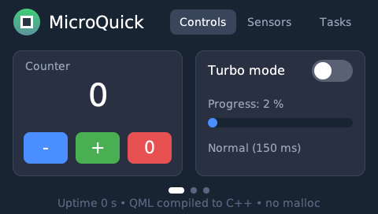
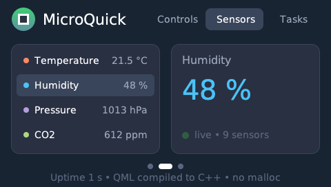
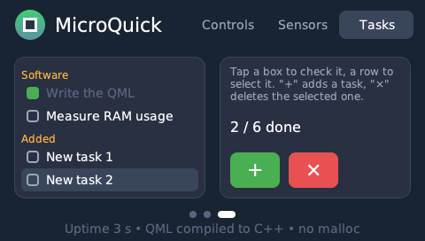

# MicroQuick

**Write microcontroller UIs in QML. Ship them as plain C++.**

MicroQuick is a small, Qt Quick-like UI framework for microcontrollers, in the
spirit of Qt for MCUs (Qt Quick Ultralite). You describe the interface in
**QML**; a compiler (`mqc`) translates it to **C++ at build time**; a compact
C++17 runtime renders it on the device:

- no JavaScript engine, no interpreter, no exceptions, no RTTI;
- **no dynamic memory allocation**: the whole UI is one statically sized object;
- partial rendering into an RGB565 framebuffer: only changed pixels are redrawn;
- a desktop simulator (Qt 6) to iterate quickly, and a ready-made
  **ESP32 / M5Stack Core2** port for PlatformIO.

| Controls | Sensors (ListView) | Tasks (editable ListModel, sections, Loader) |
|---|---|---|
|  |  |  |

> MicroQuick is an independent project. It is not affiliated with, nor endorsed
> by, The Qt Company. "Qt" and "Qt Quick" are trademarks of The Qt Company.

---

## Contents

- [How it works](#how-it-works)
- [Requirements](#requirements)
- [Quick start (desktop simulator)](#quick-start-desktop-simulator)
- [Your first application](#your-first-application)
- [Running on an M5Stack Core2 (ESP32, PlatformIO)](#running-on-an-m5stack-core2-esp32-platformio)
- [Porting to another board](#porting-to-another-board)
- [Supported QML](#supported-qml)
- [Differences from Qt Quick](#differences-from-qt-quick)
- [Configuration and memory](#configuration-and-memory)
- [Project layout](#project-layout)
- [Tests](#tests)

---

## How it works

```
 Main.qml, Button.qml …
        │
        ▼
 mqc (Python) ──► mq_app.h / mq_app.cpp      one C++ class per QML file
        │
        └──────► mq_assets.txt ──► mqassets (Qt 6 host tool) ──► mq_assets.cpp
                                     fonts pre-rasterized, images converted
        │
        ▼
 your firmware  +  microquick runtime (C++17)  ──►  display & touch
```

- Each QML file becomes a C++ class; child objects, bindings, signal handlers
  and states become members. The application is a single object whose size is
  known at compile time.
- Bindings track their dependencies automatically and update synchronously,
  exactly like QML bindings.
- QML is **statically typed** by the compiler: mistakes are reported at build
  time with file and line, e.g.
  `Main.qml:12:5: error: 'Rectangle' has no property 'colour'`.
- Fonts are rasterized at build time, only for the pixel sizes and characters
  your QML uses. Images are converted to RGB565 (opaque) or ARGB8888.

## Requirements

| To… | You need |
|---|---|
| compile QML | Python 3 (no extra package) |
| convert fonts / images, run the simulator | Qt 6 (Core, Gui) and CMake ≥ 3.21 |
| build for a board | the board's toolchain (e.g. PlatformIO for the ESP32) |

Qt is only used **on the host**. Nothing from Qt runs on the microcontroller.

## Quick start (desktop simulator)

```bash
git clone <this repository> MicroQuick
cd MicroQuick
cmake -S . -B build -G Ninja -DCMAKE_PREFIX_PATH=$HOME/Qt/6.12.0/macos   # path of your Qt 6 kit
cmake --build build
./build/examples/demo/demo          # 480x272 demo, window zoomed x2
./build/examples/core2/core2_demo   # 320x240 demo (same UI as the Core2 firmware)
```

On Linux the Qt kit is typically `~/Qt/6.x.y/gcc_64`, on Windows
`C:/Qt/6.x.y/msvc2022_64`.

Simulator options:

| Option | Effect |
|---|---|
| `--zoom N` | window scale factor (default 2) |
| `--offscreen` | no window (CI, scripts) |
| `--script "…"` | automation: `wait MS; press X Y; move X Y; release X Y; click X Y; screenshot FILE.png; quit` |

```bash
./build/examples/demo/demo --offscreen --script "wait 500; click 124 188; screenshot out.png; quit"
```

## Your first application

**1. Write the UI** — `myapp/Main.qml`:

```qml
import QtQuick

Rectangle {
    id: root
    width: 320
    height: 240
    color: "#1e2430"

    property int count: 0

    Text {
        anchors.centerIn: parent
        text: "Clicked " + root.count + " times"
        color: root.count >= 10 ? "orange" : "white"
        font.pixelSize: 22
        Behavior on color { ColorAnimation { duration: 300 } }
    }

    MouseArea {
        anchors.fill: parent
        onClicked: root.count++
    }
}
```

Reusable components are ordinary QML files: `Button.qml` defines a `Button`
type (see [`examples/demo/Button.qml`](examples/demo/Button.qml)).

**2. Declare it in CMake** — `myapp/CMakeLists.txt`:

```cmake
mq_add_qml_app(myapp_ui
    MAIN Main.qml
    QML_FILES Button.qml            # other components, if any
    ASSETS images/logo.png          # images reachable from computed sources
)
mq_add_simulator(myapp myapp_ui)    # desktop simulator executable
```

Add `add_subdirectory(myapp)` to the top-level `CMakeLists.txt`, build, and run
`./build/myapp/myapp`.

`mq_add_qml_app` produces a static library exposing one function,
`mq::Item *mq_app_root()`, which creates the UI on first call. Optional
argument: `FONT path/to/font.ttf` (default: DejaVu Sans).

**3. Run it on hardware** — link `myapp_ui` into your firmware and drive it as
shown in [Porting to another board](#porting-to-another-board), or use the
ready-made [Core2 port](#running-on-an-m5stack-core2-esp32-platformio).

### Calling the UI from C++

The generated classes are plain C++: every QML property is a public member.

```cpp
#include "mq_app.h"                 // generated header

auto *ui = static_cast<Main *>(mq_app_root());
ui->count.set(42);                  // like an assignment in QML: bindings update
int n = ui->count.value();          // read
```

## Running on an M5Stack Core2 (ESP32, PlatformIO)

[`ports/m5stack-core2`](ports/m5stack-core2/README.md) is a complete
PlatformIO project for the **M5Stack Core2** (ESP32, 8 MB PSRAM, ILI9342C
320x240 display, FT6336U capacitive touch, AXP192 power management).

1. Install **VS Code** and the **PlatformIO IDE** extension (and Qt 6 for the
   asset tool).
2. *File › Open Folder…* → `ports/m5stack-core2` (the folder containing
   `platformio.ini`).
3. Plug in the Core2, then **Build**, **Upload** and **Monitor** from the
   PlatformIO toolbar.

Or from a terminal:

```bash
cd ports/m5stack-core2
pio run -t upload && pio device monitor
```

Before each build, `scripts/mq_generate.py` compiles
[`examples/core2/Main.qml`](examples/core2/Main.qml) to C++ and converts its
assets (only when something changed). To use your own UI, change
`custom_mq_main`, `custom_mq_qml` and `custom_mq_assets` in `platformio.ini`.
`console.log()` output appears in the serial monitor.

Measured on the device: ≈ 866 KB of flash, ≈ 200 KB of internal heap still
free after startup.

## Porting to another board

The runtime needs three things from the platform: a framebuffer, the time, and
touch events. A complete template is in
[`platform/mcu_template/main.cpp`](platform/mcu_template/main.cpp):

```cpp
#include <mq/mq.h>
mq::Item *mq_app_root();

static uint16_t framebuffer[480 * 272];          // RGB565

int main()
{
    mq::Window *window = mq::Window::instance();
    window->setFramebuffer(framebuffer, 480, 272);
    window->setRoot(mq_app_root());

    for (;;) {
        // 1. touch input
        if (touch_pressed())      window->pointerEvent(mq::PointerAction::Press, x, y);
        else if (touch_moved())   window->pointerEvent(mq::PointerAction::Move, x, y);
        else if (touch_released())window->pointerEvent(mq::PointerAction::Release, x, y);

        // 2. timers, animations, layout, rendering
        mq::Rect dirty[MQ_MAX_DIRTY_RECTS];
        int n = window->processFrame(millis(), dirty);

        // 3. push only the repainted rectangles to the display
        for (int i = 0; i < n; ++i)
            display_flush(framebuffer, 480, dirty[i].x, dirty[i].y, dirty[i].w, dirty[i].h);
    }
}
```

Optional hooks: define `mq::log(const char *)` to route `console.log()` (to a
UART, for example) and `mq::fatal(const char *)` for unrecoverable errors.

For a Cortex-M target with CMake, a toolchain file is provided. Build the host
tools first, then:

```bash
cmake --build build --target mqassets
cmake -S . -B build-arm -G Ninja -DCMAKE_TOOLCHAIN_FILE=cmake/arm-none-eabi.cmake \
      -DMQ_ASSETS_EXECUTABLE=$PWD/build/tools/mqassets/mqassets
```

If the static RAM segment of your MCU is too small for the application state
(as on the ESP32), compile with `-DMQ_APP_PLATFORM_STORAGE` and provide
`void *mq_platform_alloc(size_t size, size_t align)`: it is called once at
startup, and nothing is allocated afterwards.

## Supported QML

| Area | Supported |
|---|---|
| Visual types | `Item`, `Rectangle` (radius, border, anti-aliasing), `Text`, `Image` (Stretch/Pad/Tile), `MouseArea`, `Row`, `Column`, `Flickable`, `ListView`, `GridView`, `Repeater`, `Loader` |
| Text | multi-line, alignment, `wrapMode` (`WordWrap`, `WrapAnywhere`, `Wrap`), `elide` (`ElideLeft/Right/Middle`), `maximumLineCount`, `lineCount` |
| Layout | anchors (`fill`, `centerIn`, edges, centers, margins, offsets), `Row`/`Column` with `spacing`, implicit sizes |
| Components | one `Foo.qml` file = one `Foo` type; reusable `Component { id: … }`; `property` (int, real, bool, string, color, url, `list<T>`, `var` with an inferred type), `readonly`, `property alias`, `signal` with parameters, `function` |
| Bindings | automatic dependency tracking, synchronous updates, imperative assignment breaks a binding (as in QML) |
| Handlers | `onClicked`, `onXxxChanged`, custom signals (`onMoved: (dx) => …`), `Component.onCompleted` |
| JavaScript | `var/let/const`, `if/else`, `for`, `while`, `return`, operators, ternary, `&&`/`||` returning an operand, string concatenation, array literals (`[1, 2, 3]`, `a[i]`, `.length`), `Math.*`, `Qt.rgba/rgb/darker/lighter`, `toFixed`, `parseInt/parseFloat`, `console.log` |
| Functions | type annotations optional: an untyped function is specialized for the argument types of each call; return types are inferred |
| States | `states`, `when` (combinable with explicit `state` assignments), `PropertyChanges` (classic and Qt 6 syntax) |
| Transitions | `Transition { from; to; reversible }` with `NumberAnimation`/`ColorAnimation` (`properties`, `targets`), `SequentialAnimation`, `ParallelAnimation`, `PauseAnimation` |
| Animations | `NumberAnimation`, `ColorAnimation`, `SpringAnimation`, `SmoothedAnimation`, `PauseAnimation`, `SequentialAnimation`, `ParallelAnimation`, `Behavior on …`, `… on prop`; `loops`, `Animation.Infinite`, 13 `Easing.*` curves |
| Timers | `Timer` (`interval`, `running`, `repeat`, `triggeredOnStart`, `start()/stop()/restart()`) |
| Models | `ListModel`/`ListElement` (const data in flash, or in RAM when modified: `append`, `insert`, `remove`, `clear`, `move`, `set`, `setProperty`, `get(i).role`), integer models, arrays |
| ListView / GridView | recycled delegates, variable delegate sizes, kinetic scrolling, `highlight`, `header`, `footer`, `section.property` + `section.delegate`, `currentIndex`, `incrementCurrentIndex()`, `positionViewAtIndex()`, `ListView.isCurrentItem`, `ListView.view`, `cellWidth/cellHeight/flow` |
| Loader | `sourceComponent` (Component ids) or `source: "Page.qml"`, `active`, `item`, `onLoaded` |
| Resources | fonts (TTF, rasterized at build time), PNG/JPG images; an image `source` may be computed (`"icons/" + name + ".png"`) if the image is mentioned in the QML or listed in `ASSETS` |

The examples are the best reference:
[`examples/demo`](examples/demo/Main.qml) (480x272, three pages) and
[`examples/core2`](examples/core2/Main.qml) (320x240).

## Differences from Qt Quick

These follow from the "no allocation, no JavaScript engine" design (Qt for
MCUs makes similar choices):

- **No generic JavaScript objects** and no mutable arrays: use a `ListModel`
  (fixed capacity). Object literals `{…}` are accepted by model methods.
- **No dynamic creation** (`createObject`): everything that can exist is known
  at build time (`Loader`, `Repeater`, views).
- **Capacities are fixed at build time**: rows of a modified `ListModel`
  (`capacity: N`), delegates of a view (computed from the view and delegate
  sizes, or `capacity: N`), dynamic `Repeater`. The compiler warns when it has
  to choose a default.
- **Integer pixel geometry** (`x`, `width`, … are `int`).
- A string built by concatenation is limited to `MQ_STRING_CAPACITY` bytes;
  string literals are never copied and have no limit.
- `positionViewAtIndex()` always aligns the start of the item.

## Configuration and memory

Compile-time options of the runtime (`-D…`):

| Macro | Default | Meaning |
|---|---|---|
| `MQ_STRING_CAPACITY` | 64 | bytes stored inline by a built string |
| `MQ_MAX_DIRTY_RECTS` | 4 | dirty rectangles merged per frame |
| `MQ_DEFAULT_LINK_POOL` | 256 | binding links when the application registers no pool |
| `MQ_APP_PLATFORM_STORAGE` | off | the platform provides the application memory at startup |

Binding dependencies come from a shared pool sized by the compiler. The
simulator prints the peak actually used when it exits
(`MicroQuick: dependency links peak 256 / 833 reserved`), and the Core2 port
prints it every 10 seconds, to help tune memory.

Indicative footprint (host build, `MinSizeRel`): runtime ≈ 47 KB of code; the
480x272 demo ≈ 45 KB of generated code, ≈ 135 KB of state on 64-bit (about half
on a 32-bit MCU); fonts ≈ 170 KB of flash; a 480x272 RGB565 framebuffer is
255 KB.

## Project layout

```
runtime/                C++17 runtime library ("microquick"), built for the target
  include/mq/           property.h, items.h, painter.h, window.h, animation.h, views.h…
  src/                  implementation (also usable as a PlatformIO library)
tools/mqc/              QML → C++ compiler (Python 3, no dependency)
tools/mqassets/         Qt 6 host tool: font rasterization, image conversion
platform/simulator/     desktop simulator (Qt 6)
platform/mcu_template/  board port template
ports/m5stack-core2/    PlatformIO project for the M5Stack Core2 (ESP32)
cmake/                  mq_add_qml_app(), arm-none-eabi toolchain file
examples/demo/          480x272 demo (Button, Switch, ProgressBar components)
examples/core2/         320x240 demo used by the Core2 port
fonts/                  DejaVu Sans (default font)
tests/                  runtime, end-to-end and compiler tests
```

## Tests

```bash
cd build && ctest --output-on-failure
```

- `runtime`: properties, bindings, signals, strings, rasterizer, dirty regions,
  animations, Flickable, ListView/GridView, Loader…
- `demo`: the demo compiled from QML, driven headless with a virtual clock and
  synthetic touches; also checks that **no dynamic allocation** happens.
- `mqc`: compiler tests, including compiling the generated C++.

## Font license

[`fonts/DejaVuSans.ttf`](fonts/DejaVuSans.ttf) comes from the Qt 6 sources
(Bitstream Vera license, see [`fonts/DEJAVU-LICENSE`](fonts/DEJAVU-LICENSE)).
